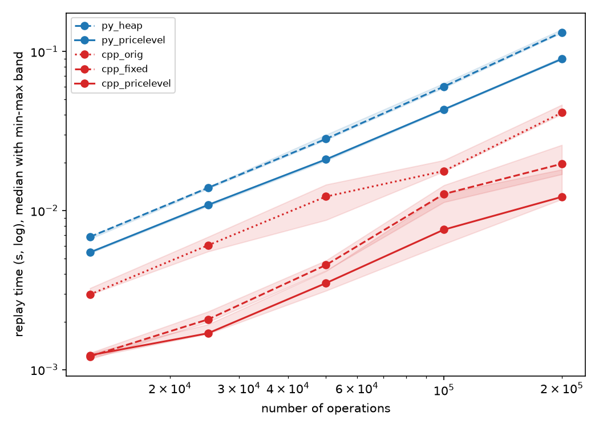
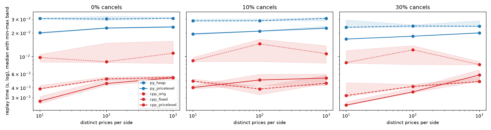

# Matching Engine Architecture Benchmark

## Overview

### What's an Matching Engine ?

A matching engine is the core component of an electronic exchange. It receives buy and sell orders, applies price-time priority rules, and automatically matches compatible orders to generate trades.

A limit order book matching engine maintains outstanding orders, executes trades when prices cross, handles cancellations and partial fills, and continuously updates the best bid and best ask available in the market.

### The goal of the project

This project compares multiple limit order book implementations written in Python and C++. The goal is to evaluate how language choice, implementation quality, and underlying data structures affect matching-engine performance.

The study compares heap-based and price-level order books under identical workloads and measures latency across a variety of market conditions.


> **Note:** The following benchmarks compare five functionally equivalent matching engines. All implementations use efficient data structures and logarithmic-time (or better) core operations, allowing the study to focus on the practical impact of language choice, implementation quality, and architecture.
---

## Results

### Runtime vs Number of Operations



**Key observations**

- The price-level architecture consistently outperformed the heap-based architecture in both Python and C++, delivering lower execution times across the tested workloads.

- C++ significantly outperformed Python in terms of runtime. Even the straightforward, Python-inspired C++ implementation (cpp_orig) was faster than the Python price-level implementation, highlighting the impact of language choice on performance.

- For both implementations, the price-level architecture demonstrated superior scalability as workload size increased, with the performance gap widening relative to the heap-based implementations at larger operation counts.

---

### Runtime vs Price Levels



**Key observations**

- Language choice had a larger effect on runtime than market depth. All C++ implementations substantially outperformed both Python implementations across every tested configuration.
- Implementation quality had a substantial impact on performance. The optimized heap-based C++ implementation consistently achieved much lower runtimes than the original heap implementation (cpp_orig) despite using the same underlying architecture.
- The optimized C++ heap implementation (cpp_fixed) remained highly competitive with the C++ price-level implementation (cpp_pricelevel). The performance gap between the two architectures was smaller than the gap between the original and optimized heap implementations.

---

## Main Findings

- Moving from a naive implementation to an idiomatic one produced performance gains comparable to moving from Python to C++.
- Efficient use of a language and its data structures mattered at least as much as the choice of language itself.
- The price-level architecture consistently achieved the best performance and scalability.
- A carefully engineered heap-based implementation remained surprisingly competitive, narrowing much of the gap between the two architectures.
- Cancellation rate had relatively little impact on performance, suggesting that lazy-cancellation overhead was not a dominant cost under the tested workloads.

---
## Results at a Glance

| Comparison | Result |
|------------|--------|
| `cpp_orig` → `cpp_fixed` | ~2.2× faster (41 ms → 19 ms at 200k ops) |
| `py_heap` → `cpp_orig` | ~3.2× faster (132 ms → 41 ms at 200k ops) |
| `py_heap` → `cpp_pricelevel` | ~11× faster (132 ms → 12 ms at 200k ops) |
| Fastest implementation | `cpp_pricelevel` |
| Largest improvement | Optimizing the C++ heap implementation (`cpp_orig` → `cpp_fixed`) |
---

## Interpretation of results

- Language choice and implementation quality had comparable impacts on performance. The improvement obtained by moving from the original C++ implementation (cpp_orig) to the idiomatic version (cpp_fixed) was of the same order of magnitude as the improvement obtained by moving from Python to C++, highlighting the importance of language-specific data structures and coding practices.

- Careful implementation choices were often as important as architectural decisions. While the price-level architecture consistently delivered the best performance, a well-engineered heap-based implementation remained highly competitive despite using a simpler design.

- Architecture became increasingly important as workload size grew. The price-level order book exhibited the best scalability and maintained its advantage at larger operation counts, although the performance gap was smaller than initially expected.

---

## Implementations

Because C++ is not my strongest language, I first implemented a direct translation of the Python order book (cpp_orig) before developing a more idiomatic C++ version (cpp_fixed). This allowed me to measure how much performance improvement comes from adopting language-specific practices rather than simply changing languages.

| Implementation | Language | Architecture |
|---------------|----------|-------------|
| py_heap | Python | Heap-of-orders |
| py_pricelevel | Python | Price-level |
| cpp_orig | C++ | Heap-of-orders (naive) |
| cpp_fixed | C++ | Heap-of-orders (optimized) |
| cpp_pricelevel | C++ | Price-level |

---

## Order Book Features

All implementations support:

- Limit orders
- Partial fills
- Exact fills
- Price-time priority
- FIFO within a price level
- Order cancellation
- Best bid / best ask queries

Additional heap-based features:

- Lazy cancellation
- Heap pruning of stale orders

---

## Architectures

### Heap-Based Order Book

#### Description

A heap-based order book stores individual orders directly in priority queues. Buy orders are organized in a max-heap and sell orders in a min-heap, ensuring that the best available prices can be accessed efficiently. Price-time priority is maintained using a sequence number, and cancellations are handled through lazy deletion.

#### Advantages

- Simple and relatively straightforward to implement.
- Efficient access to the best bid and ask prices.
- Naturally supports price-time priority using heap ordering.

#### Disadvantages

- Orders at the same price are stored independently rather than grouped together.
- Lazy cancellation leaves stale entries in the heap that must eventually be pruned.
- Matching performance can degrade as the number of individual orders grows.

---

### Price-Level Order Book

#### Description

A price-level order book groups orders by price. Each price level maintains a queue of orders to preserve FIFO priority, while a separate structure tracks the best available price levels. Matching is performed at the level of prices rather than individual orders.

#### Advantages

- Orders at the same price are processed efficiently through dedicated FIFO queues.
- Reduces the amount of work required to locate and match orders.
- Exhibits better scalability as workload size increases.
- Eliminates the need for heap pruning caused by lazy cancellation.

#### Disadvantages

- More complex to implement and maintain correctly.
- Requires additional data structures to manage both price levels and order queues.
- Performance gains may be modest for smaller workloads despite the added complexity.
---

## Benchmark Methodology

### Workload Generation

Synthetic workloads are generated using a reproducible random process.

Parameters include:

- Number of operations
- Number of distinct price levels
- Cancellation ratio
- Aggressive order frequency

Example operation format:

```text
A 1 B 1000 5
A 2 S 1001 3
C 1
```

Where:

- `A` = add order
- `C` = cancel order
- `B` = buy side
- `S` = sell side
---

### Correctness Validation

Before comparing performance, all implementations are required to produce identical outcomes:

- Number of fills
- Traded quantity
- Successful cancellations
- Final best bid
- Final best ask

This ensures performance comparisons are made between functionally equivalent implementations.

---

### Experimental Setup

#### Price-Level Sweep

Purpose:

> Measure the effect of market depth.

Parameters:

- Distinct price levels: 10, 100, 1000
- Fixed operation count
- Multiple cancellation rates

---

#### Cancellation Sweep

Purpose:

> Measure the impact of cancellations and lazy deletion.

Parameters:

- Cancellation ratio from 0% to 10%
- Fixed operation count
- Fixed price depth

---

#### Scaling Sweep

Purpose:

> Measure how each implementation scales with workload size.

Parameters:

- 12.5k operations
- 25k operations
- 50k operations
- 100k operations
- 200k operations

---

## Lessons Learned

- Knowing the syntax of a language does not mean knowing how to use that language effectively. The performance difference between `cpp_orig` and `cpp_fixed` showed that understanding a language's idioms, data structures, and best practices can have an impact comparable to switching languages entirely.

- Performance is the result of many interacting factors. Architecture, data structures, algorithmic complexity, language choice, implementation quality, and familiarity with the language all contribute to the final outcome.

- Benchmarking requires more than measuring execution time. Ensuring that all implementations produce identical results is essential before drawing conclusions from performance data.

- The most efficient architecture is not always overwhelmingly faster. A carefully engineered heap-based implementation remained surprisingly competitive with a more sophisticated price-level design.

---

## Repository Structure

```text
.
├── Versions
│   ├── Orderbook.py
│   ├── PriceLevelBook.py
│   ├── Orderbook.cpp
│   ├── OrderbookFixed.cpp
│   └── PriceLevelBook.cpp
│
├── Tests
│   ├── TestOrderBook.py
│   └── ...
│
├── Benchmarking
│    ├── bench.py
│    ├── bench.cpp
│    ├── gen_workload.py
│    ├── run_all.py
│    ├── plot.py
│    └── sweeps.py
│ 
└── Results
     ├── fig_crossover.png
     ├── fig_depth.png
     ├── fig_time_vs_cancels.png
     ├── fig_time_vs_price.png
     ├── results_crossover.csv
     ├── results_depth.csv
     └── results.csv
```

---

## Running the Benchmarks

Generate benchmark results:

```bash
python run_all.py --ops 50000 --runs 5
```

Generate plots:

```bash
python plot.py
```

Run scaling experiments:

```bash
python sweeps.py depth
```

Run cancellation experiments:

```bash
python sweeps.py crossover
```

---

## Technologies

- Python
- C++17
- unittest
- matplotlib

---

## AI Usage

AI-assisted tools were used during development for debugging, code review, and portions of the benchmarking infrastructure.

All architectural decisions, implementation validation, experimental design, benchmarking interpretation, and analysis of results were performed by the author.

---
Author: Akram Khellaf

Developed as an independent study of matching-engine architecture, performance engineering, and benchmarking methodology.